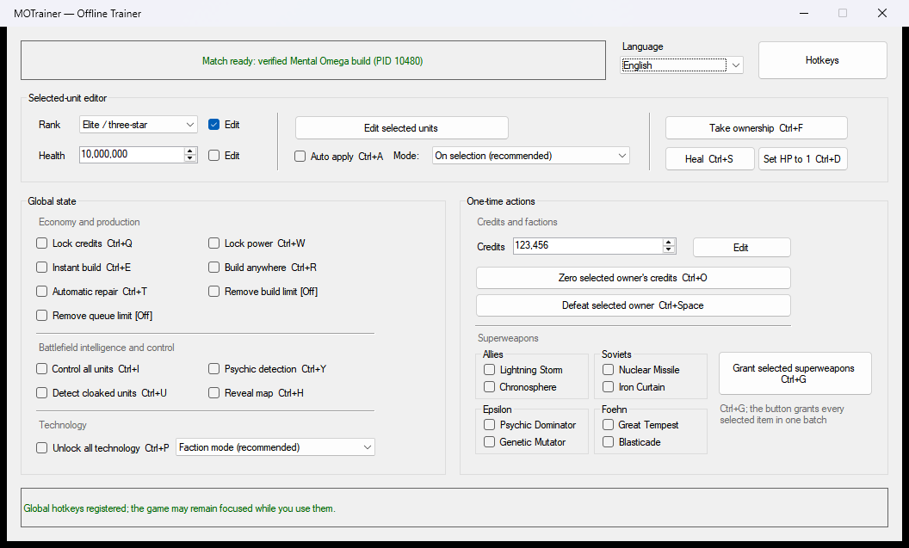

# MOTrainer

[English](README.md) | [简体中文](README.zh-CN.md)

MOTrainer is an independent, unofficial, open-source offline trainer for
[Mental Omega](https://mentalomega.com/). It provides selected-unit editing,
economy and production controls, battlefield utilities, and superweapon grants
for a strictly verified game build.

> Offline use only. MOTrainer does not provide anti-cheat bypasses and should
> not be used in multiplayer environments.



## Project status

The current source supports `Auto`, English, and Simplified Chinese display
languages in one executable. The latest public package,
[`v0.1.0-rc1`](https://github.com/cmdrmo/MOTrainer/releases/tag/v0.1.0-rc1),
predates the bilingual interface and remains the initial Chinese release
candidate. Build the current source to preview the English interface until a
new package is published.

- [Releases](https://github.com/cmdrmo/MOTrainer/releases)
- [Compatibility and troubleshooting](docs/COMPATIBILITY.md)
- [Report an issue](https://github.com/cmdrmo/MOTrainer/issues)

## Features

### Selected-unit editor

- Edit veterancy and health for selected units owned by the current player.
- Apply once when a selection is formed, or continuously in compatibility
  mode.
- Transfer selected units to the current player.
- Heal all selected objects or set their health to 1 regardless of ownership.

### Persistent match controls

- Lock credits and power.
- Current-player-only instant production.
- Build anywhere and automatic repair.
- Remove build-count and queue limits.
- Control all units, detect psychic effects, reveal cloaked units, and reveal
  the map.
- Safe technology unlock with faction and extended modes.

Build-count and queue-limit options may be preset before entering a match. They
remain pending and apply only after the required game structures are available.

### One-time actions

- Set current-player credits.
- Zero the faction economy identified by the first selected object.
- Mark that faction as surrendered.
- Grant any selected combination of eight faction superweapons.

Every hotkey can be changed, saved, or restored from inside the application.
Hotkeys and mouse controls call the same validated action paths.

## Compatibility

| Requirement | Supported scope |
| --- | --- |
| Operating system | Windows |
| Game process | 32-bit `gamemd.exe` |
| Default runtime | .NET Framework 4.8 |
| Display language | Auto, English, Simplified Chinese |
| Intended use | Mental Omega offline matches |

MOTrainer validates the SHA-256 fingerprints of `gamemd.exe` and `Ares.dll`.
Unknown modules, unavailable match structures, inconsistent bytes, or failed
readback cause the affected operation to be refused. The program does not guess
addresses for an unknown build.

See [Compatibility and troubleshooting](docs/COMPATIBILITY.md) for the verified
fingerprints, status meanings, permissions guidance, and issue-reporting
requirements.

## Download and use

Download packages only from this repository's
[GitHub Releases](https://github.com/cmdrmo/MOTrainer/releases). Avoid
third-party repacks. When a `.sha256` file is provided, verify the ZIP before
extracting it.

The original `v0.1.0-rc1` package contains three files that must remain in the
same directory:

```text
MOTrainer.exe
MOTrainer.Core.dll
MOTrainer.exe.config
```

Bilingual builds also contain a `zh-Hans` directory with two satellite resource
DLLs. Keep that directory beside `MOTrainer.exe`; removing it disables the
Simplified Chinese resources.

1. Start Mental Omega.
2. Start `MOTrainer.exe` at the same privilege level as the game.
3. Wait for the top status bar to confirm the game build.
4. Enter an offline match and use the required controls.

`MOTrainer.exe.config` stores the language, editor values, selected
superweapons, feature modes, and custom hotkeys. Back it up before replacing a
release if you want to preserve those settings. If an older configuration is
reported as invalid, restore the default configuration included with the new
package.

Install the official
[.NET Framework 4.8 Runtime](https://dotnet.microsoft.com/download/dotnet-framework/net48)
if it is not already available.

## Safety model

MOTrainer does not copy or modify Mental Omega game files. It reads and writes
the running game process and attempts to restore persistent patches installed
by the current trainer instance when the trainer exits.

One-time results cannot be undone automatically. Some changes may also be
retained by the game in the current save. Save your progress before testing a
release candidate.

Opening another process, writing memory, allocating temporary remote code pages,
and registering global hotkeys may trigger heuristic antivirus detection. Use
only official release assets, verify the published SHA-256, and review or build
the source if you remain uncertain. The project does not ask users to disable
security software or exclude an entire game directory.

## Build from source

Install a .NET SDK capable of building both .NET 8 and .NET Framework 4.8
targets, then run:

```powershell
dotnet build .\app\MOTrainer.sln --configuration Release
dotnet run --project .\app\tests\MOTrainer.Core.SmokeTests `
  --configuration Release
```

The current suite contains 37 smoke tests covering core state transitions,
safety refusals, rollback paths, localization resources, and settings
compatibility. These tests do not replace validation against the exact supported
Mental Omega build.

Publish the compact x86 .NET Framework build with:

```powershell
dotnet publish .\app\src\MOTrainer.WinForms\MOTrainer.WinForms.csproj `
  --configuration Release `
  --framework net48 `
  -p:PlatformTarget=x86 `
  -p:DebugType=None `
  -p:DebugSymbols=false `
  --no-self-contained `
  --output .\dist\win-x86-net48
```

## Repository layout

```text
app/src/MOTrainer.Core/              process, memory, profiles, and safety logic
app/src/MOTrainer.WinForms/          Windows user interface
app/tests/MOTrainer.Core.SmokeTests/ lightweight smoke-test harness
docs/                                compatibility and maintenance notes
```

Future structural work follows an incremental approach: refactor along real
feature boundaries without weakening version checks, readback, rollback, or
shutdown restoration. The current internal plan is available in
[Simplified Chinese](docs/MAINTENANCE_PLAN.md).

## Independence and acknowledgements

MOTrainer is not affiliated with or endorsed by Mental Omega, Electronic Arts,
or any existing trainer project. It is independently implemented from public
documentation, observable behavior, community research, and validation against
the supported build. See [Acknowledgements and project boundaries](ACKNOWLEDGEMENTS.md).

This repository does not contain or distribute the game, Mental Omega files,
third-party trainer files, or their assets.

## License

MOTrainer source code is licensed under the
[GNU General Public License v3.0 only](LICENSE) (`GPL-3.0-only`). The license does
not grant rights to any third-party games, mods, names, or assets.
